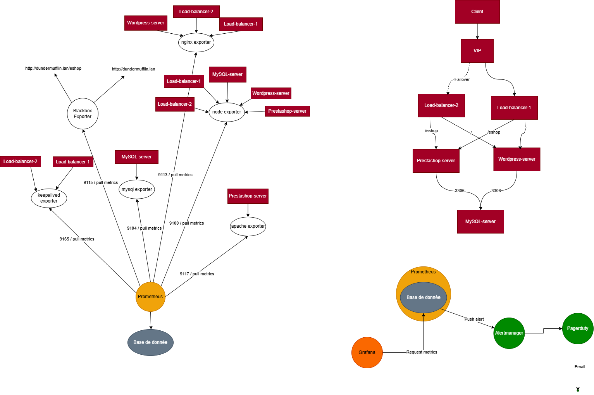

# 3MIN

Nous devons monitorer l'infrastructure Dundermifflin, pour ce faire nous utilisons des solutions open source, notamment la suite Grafana + Prometheus.
## 📦 Services utilisés

| Service                     | Description                                                             |
|-----------------------------|-------------------------------------------------------------------------|
| **Prometheus**              | Collecte les métriques via différents exporters.                        |
| **Grafana**                 | Visualisation des métriques via des dashboards.                         |
| **Node Exporter**           | Suivi des ressources système (CPU, RAM, disque).                        |
| **Blackbox Exporter**       | Vérification de la disponibilité de sites ou services via HTTP/ICMP/TCP. |
| **Keepalived Exporter**     | Suivi des états de basculement (VRRP).                                  |
| **Nginx / Apache Exporter** | Suivi des métriques des serveurs web.                                   |
| **Mysqld Exporter**         | Suivi des métriques de la base de donnée.                               |

# ✨ Prérequis

- Copier ``.env.example`` en ``.env`` et remplacer chaque ``XXX`` (versions, webhook Discord, identifiants).
- Renseigner les targets de chaque exporter dans ``prometheus/targets/<job>.json`` (modèle : ``node.json.example``).
- Installer les exporters sur vos serveurs avec les scripts du dossier ``exporter/`` : ils
  les protègent par basic auth, avec les identifiants du ``.env``
  (cf. [doc/securisation-exporters.md](doc/securisation-exporters.md)) :
````bash
sudo NODE_BASIC_AUTH_USERNAME=prometheus VERSION=X.Y.Z ./exporter/node_exporter.sh   # mot de passe demandé
````

La documentation détaillée est dans le dossier [`doc/`](doc) :

- [Configuration (.env, templates, targets, rules)](doc/configuration.md)
- [Alertmanager → Discord](doc/alertmanager-discord.md)
- [Grafana (configuration, import de dashboards)](doc/grafana.md)
- [Installation et sécurisation des exporters](doc/securisation-exporters.md)
- [Déploiement avec Ansible](doc/ansible.md)
- [CI (lint, build, vérifications)](doc/ci.md)

## 🧱 Lancé le projet

L'ensemble des services est déployé via Docker Compose, lancé cette commande à la racine du projet  : 
```bash
docker compose up -d --build
``` 
Grafana est accessible sur le port `3000` (compte admin du `.env`) et Prometheus sur le port `9090` (basic auth `PROMETHEUS_BASIC_AUTH_*` du `.env`). Alertmanager et Blackbox ne sont pas exposés (cf. [doc/configuration.md](doc/configuration.md#accès-aux-services)).
    
## Schéma d'infrastructure avec monitoring


## 🔄 Mise à jour

Ajouter ou modifier des targets dans ``prometheus/targets/*.json`` : Prometheus les recharge automatiquement.
Pour le reste (``.env``, templates, rules), voir [doc/configuration.md](doc/configuration.md#appliquer-une-modification).
